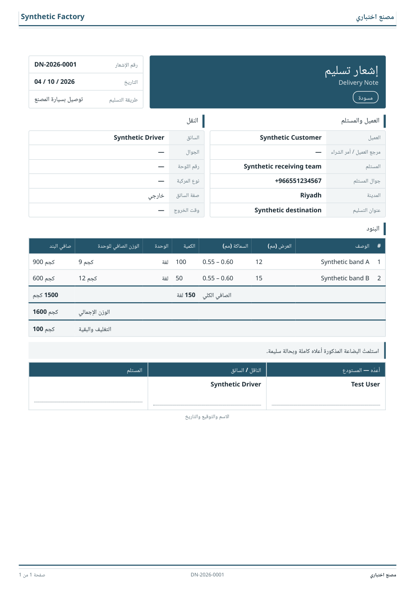
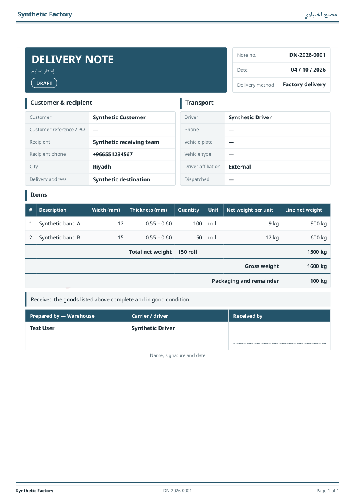

# Customers list and shipment weights

Branch: `fix/customers-list-and-shipment-weights`, from main `923acd24636be8539aa0e392d9aa571a9f738c72`.
All API/PDF examples are synthetic; no operational server was accessed.

## Behavior

- Customers: remove only phone/email headers and cells from the list. Details, API and server search are unchanged.
- New counted-quantity lines require `unit_net_weight` and `weight_unit`; the server computes and stores full-line net in `weight`. Clients cannot submit `weight`.
- Weight-quantity units use quantity converted to kg, store line net in kg, and reject even an explicitly null `unit_net_weight`. The form hides that input.
- A draft update sends the existing line ID. The server resolves it only against that shipment's own lines; a legacy null per-unit value retains the stored net/weight unit until a per-unit value is entered. Reading/printing old records never recalculates them. Weighed-quantity edits derive net when quantity/unit changes.
- Gross input uses `gross_weight` / `gross_weight_unit` and stores only `gross_weight_kg`. Packaging/remainder is a derived response/display value, never a column. Gross below total net returns HTTP 400 `GROSS_BELOW_NET`.
- Matching references the gate weight when present, otherwise entered gross. Without either, matching is null; net is never a fallback.
- Return allocation continues using the computed full `line.weight`; 20 of 100 rolls at 9 kg each returns 180 kg, not a fraction of 9 kg.
- UI previews match the server's three-decimal half-even rounding. New interface and print labels live in ar/en `shipping.json` files.

## Migration

`2026_11_22_0900_f6a1b2p5_shipment_weights.py`: revision `f6a1b2p5`, parent `f6a1b2p4`.
Adds only nullable Numeric(14,3) `shipping_shipment_lines.unit_net_weight` and `shipping_shipments.gross_weight_kg`.
No backfill; downgrade removes only those columns. A real isolated PostgreSQL 16 test checks upgrade/down/upgrade, precision/nullability and unchanged legacy net, plus the actual complete Alembic chain.

## Validation

- Shipping/return/quality/range-copy/tenant regression suites: 79 passed, 2 skipped; contact-directory/additional tenant checks: 13 passed.
- Final weight-specific API/domain tests: 13 passed, including gross validation rollback, legacy draft persistence, weighed quantities and all matching fallbacks.
- Frontend: 375 Vitest plus 93 Node tests; TypeScript and translation check passed; lint 22 warnings, no errors.
- Real API-to-renderer PDF E2E: 4 passed; delivery notes are one-page A4 portrait and visually reviewed in both languages.
- Production frontend build and full CI results are recorded in the PR.
- A pre-existing quality-specification test now waits for ProductSelect's editable textbox after catalogue loading, avoiding typing into its transient disabled select. This is test-only; quality application behavior is unchanged.

## Executed API example

[Request and full HTTP 201 response](SHIPMENT_WEIGHTS_API_EXAMPLE.json) were captured from the actual application API against an isolated test database, not handwritten mocks.
100 rolls x 9 kg + 50 rolls x 12 kg = 1500 kg net. Gross 1.6 ton = 1600 kg; packaging/remainder = 100 kg.

## Reviewed delivery notes

## Changed files

- `backend/alembic/versions/2026_11_22_0900_f6a1b2p5_shipment_weights.py`
- `backend/app/shipping/api/schemas.py`
- `backend/app/shipping/application/shipment_service.py`
- `backend/app/shipping/domain/rules.py`
- `backend/app/shipping/infrastructure/models.py`
- `backend/app/shipping/reporting/document.py`
- `backend/app/shipping/reporting/locales/ar/shipping.json`
- `backend/app/shipping/reporting/locales/en/shipping.json`
- `backend/app/shipping/reporting/templates/dn_body.html`
- `backend/app/shipping/reporting/templates/dn_styles.css`
- `backend/tests/masterdata/test_spec_ranges_flow.py`
- `backend/tests/quality/test_return_inspections.py`
- `backend/tests/security/test_cross_tenant_sweep.py`
- `backend/tests/shipping/test_returns.py`
- `backend/tests/shipping/test_shipment_weights.py`
- `backend/tests/shipping/test_shipments.py`
- `backend/tests/test_shipment_weights_migration_postgres.py`
- `backend/tests/test_spec_ranges_pdf_e2e.py`
- `docs/verification/CUSTOMERS_LIST_AND_SHIPMENT_WEIGHTS.md`
- `docs/verification/SHIPMENT_WEIGHTS_API_EXAMPLE.json`
- `docs/verification/shipment-weights/delivery-note-ar.png`
- `docs/verification/shipment-weights/delivery-note-en.png`
- `frontend/src/features/customers/customers-list-page.tsx`
- `frontend/src/features/shipments/components/ShipmentDetail.tsx`
- `frontend/src/features/shipments/components/ShipmentForm.tsx`
- `frontend/src/features/shipments/types.ts`
- `frontend/src/features/shipments/weights.ts`
- `frontend/src/i18n/locales/ar/shipping.json`
- `frontend/src/i18n/locales/en/shipping.json`
- `frontend/tests/components/customers-pagination.test.tsx`
- `frontend/tests/components/shipments.test.tsx`
- `frontend/tests/components/quality-inspections.test.tsx`
