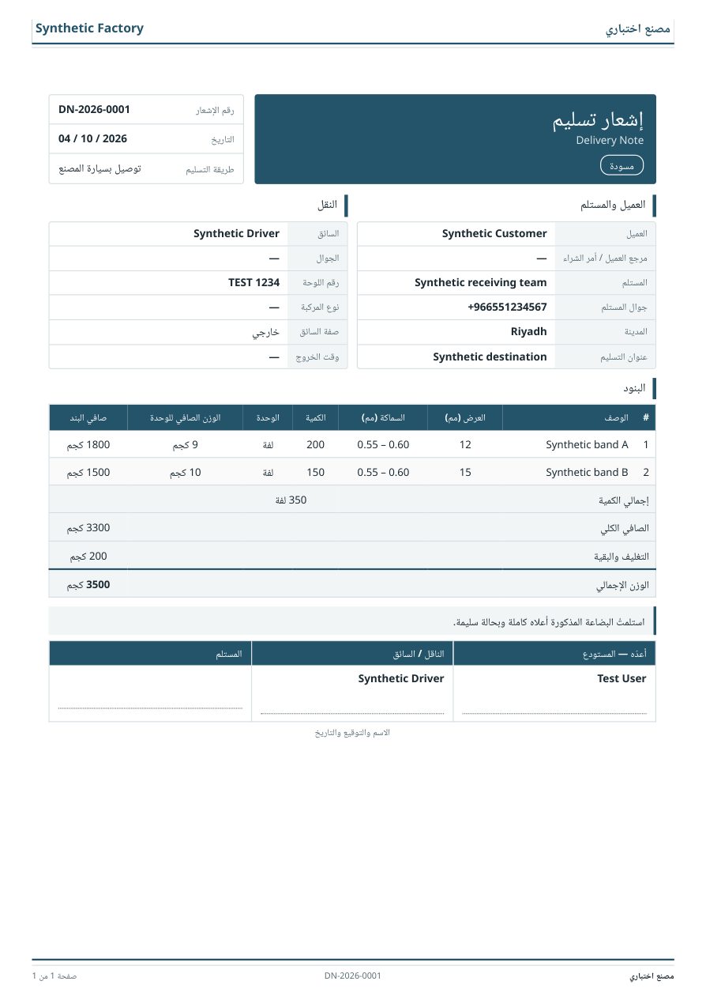
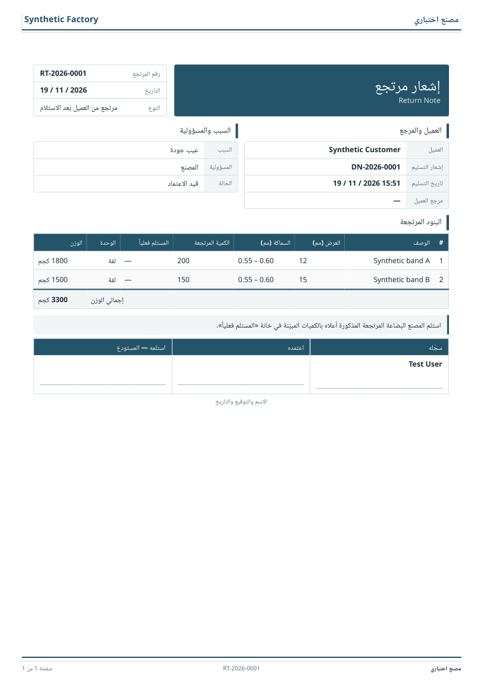
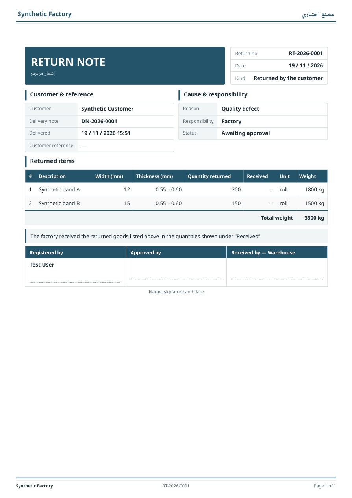

# Delivery-note totals layout verification

Base: `71aafa7`. Synthetic example: 200 rolls × 9 kg and 150 rolls × 10 kg; gross 3500 kg.

The footer now shows total quantity (350 roll), total net weight (3300 kg), packaging and remainder (200 kg), and gross weight (3500 kg), in that order. Without gross weight, only the first two rows appear. Quantity spans the quantity/unit columns; weight values occupy the final column. All labels start at the same logical table edge. Only gross weight has a thick top separator and bold text.

Delivery columns use logical start alignment for number/description and centered alignment for other headers and values. Weight numbers alone are isolated with `bdi dir="ltr"`; the unit remains outside it; the nowrap container inherits page direction. Existing quantity formatting is unchanged.

Return notes had the same combined number/unit isolation problem. Their weight formatting uses the same correction, without changing return table alignment or totals layout. No business calculations, API, schema, migrations, or application images changed.

## Verification

- Shipping tests: **62 passed, 2 skipped**.
- Real-renderer PDF tests: **8 passed**, covering Arabic/English delivery notes with/without gross weight, return notes, and existing quotation PDFs.
- PyMuPDF physical word-coordinate assertions check every weight: number x > unit x in Arabic, number x < unit x in English. Total values and footer order are also checked. Text extraction order is not a direction test.
- Arabic and English delivery-note page images visually inspected after final rendering.

## Arabic

## English

## Return-note direction verification

The return template already uses the shared `dn-weight` class; removing the forced LTR flex direction fixes it too, with no template or layout changes.

## Physical word positions (PDF points)

Arabic: number x > unit x. English: number x < unit x.

| Document | Weight | Number x | Unit x | Result |
|---|---:|---:|---:|---|
| delivery-note-ar | 9 | 162.13 | 145.70 | PASS |
| delivery-note-ar | 10 | 159.62 | 143.19 | PASS |
| delivery-note-ar | 1800 | 72.83 | 56.40 | PASS |
| delivery-note-ar | 1500 | 72.83 | 56.40 | PASS |
| delivery-note-ar | 3300 | 72.83 | 56.40 | PASS |
| delivery-note-ar | 200 | 75.35 | 58.92 | PASS |
| delivery-note-ar | 3500 | 72.83 | 56.40 | PASS |
| delivery-note-en | 9 | 415.61 | 422.92 | PASS |
| delivery-note-en | 10 | 413.10 | 425.44 | PASS |
| delivery-note-en | 1800 | 497.67 | 520.07 | PASS |
| delivery-note-en | 1500 | 497.67 | 520.07 | PASS |
| delivery-note-en | 3300 | 497.67 | 520.07 | PASS |
| delivery-note-en | 200 | 500.18 | 517.55 | PASS |
| delivery-note-en | 3500 | 497.21 | 519.61 | PASS |
| return-note-ar | 1800 | 63.43 | 47.00 | PASS |
| return-note-ar | 1500 | 63.43 | 47.00 | PASS |
| return-note-ar | 3300 | 63.43 | 47.00 | PASS |
| return-note-en | 1800 | 516.50 | 538.90 | PASS |
| return-note-en | 1500 | 516.50 | 538.90 | PASS |
| return-note-en | 3300 | 515.60 | 538.00 | PASS |
