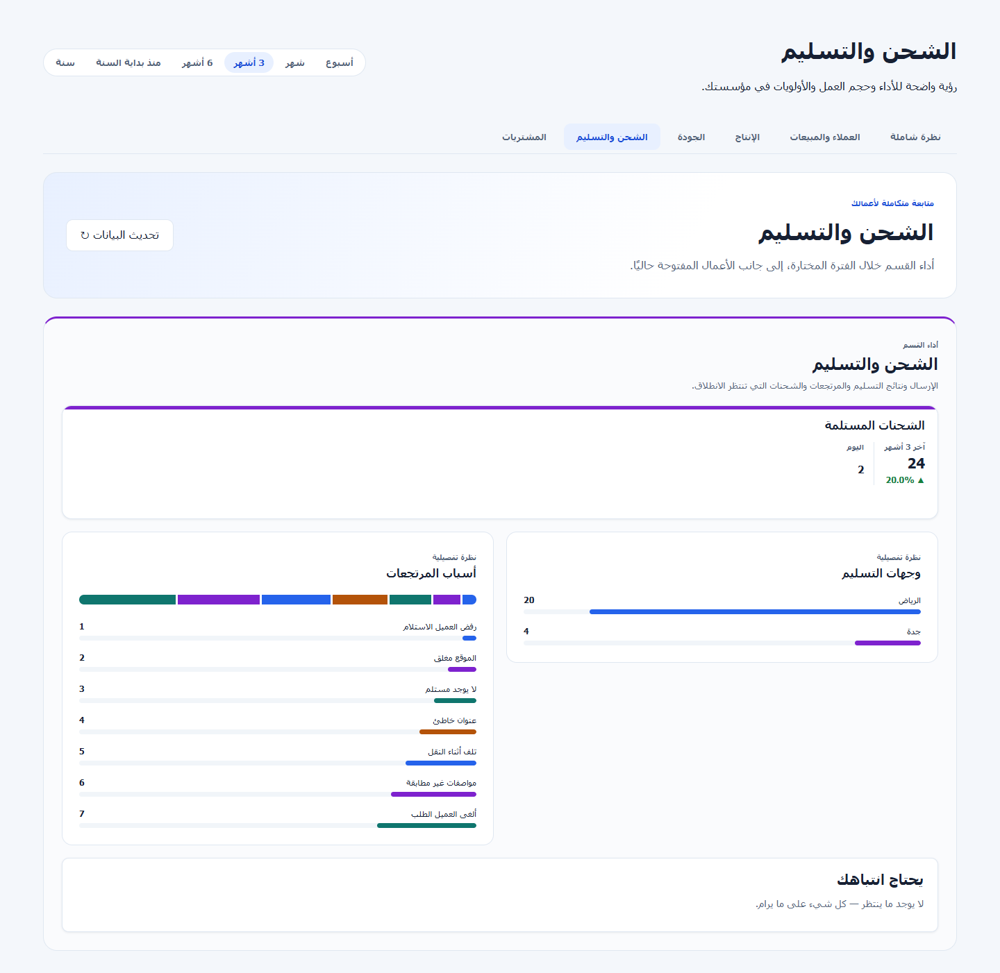
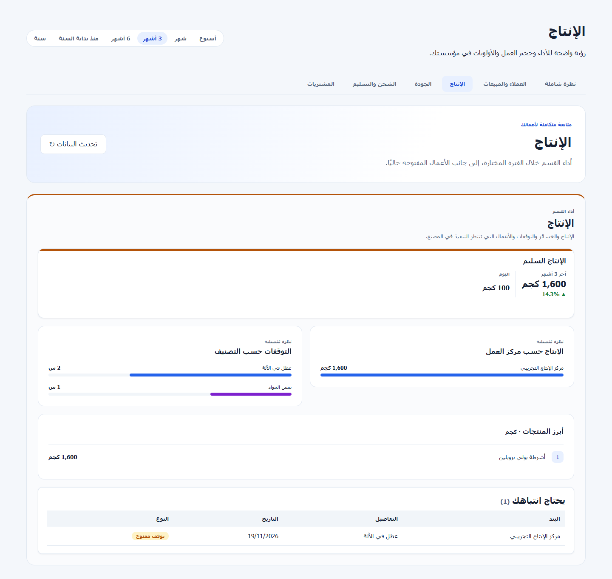
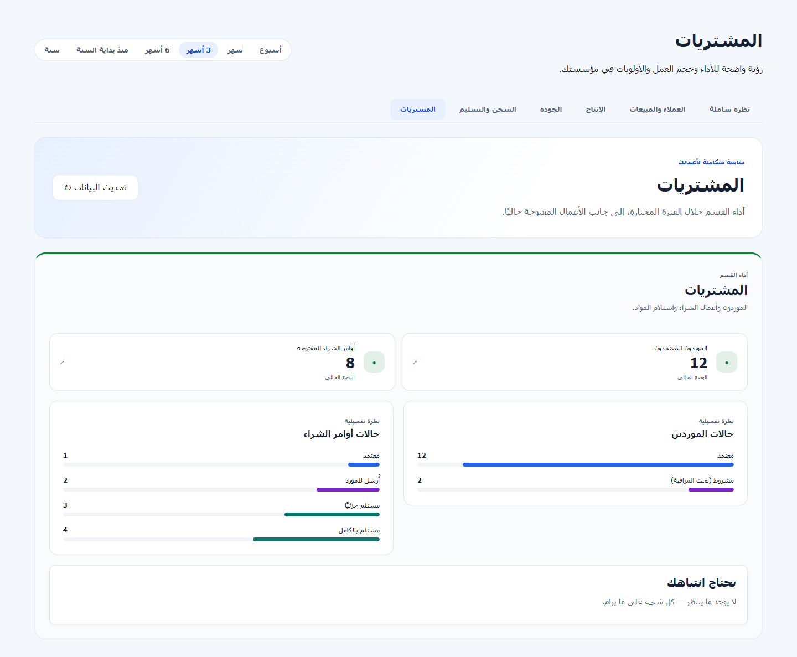
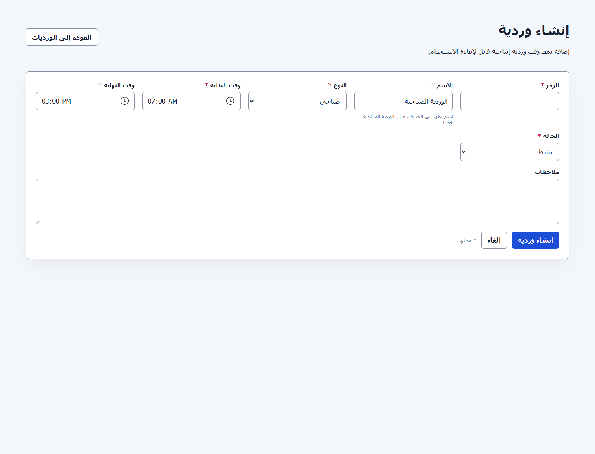

# التحقق من الثوابت المشتركة — 2أ

الأساس `dfe846f`. أول commit هو وثيقة البنية فقط: `97c5ba1`. لا تنفيذ للمرحلتين 2ب أو 2ج، ولا migrations أو تغيير في بيانات المستخدم أو المستندات المطبوعة.

## النقل والحذف

- نُقلت **503** خانة ترجمة موجودة في الواجهة إلى المصدر المشترك لكل لغة، خارج نسخ اللوحات.
- حُذفت جداول labels الخمسة من اللوحات: **965** خانة لكل لغة، منها **772** نسخة مكررة زائدة على الجدول الأول. تستخدم اللوحات الآن نوع كل توزيع وقاموسه مباشرة.
- إجمالي مسارات النصوص المحذوفة من ملفات الواجهة: **1468 لكل لغة** (503 + 965).
- انتقل مصدر أسماء **244 صلاحية وأوصافها** إلى shared: **488** خانة لكل لغة. يستمد سجل الخادم التسميات منه عبر القارئ، وتعرض الشاشات الأسماء بحسب الكود.
- يحتوي المصدر النهائي على **1060 خانة لكل لغة**؛ يشمل 69 خانة إضافية لتغطية القيم/مجموعات domain المستخرجة والقيمة القديمة للتوقفات. يحرس الاختبار **77 تعريفًا**، دون نسخ قيمها داخل الاختبار.
- `aliases.json` يحفظ 107 مسار توافق إلى القواميس الأصلية، دون نصوص مكررة. لم تُعد كتابة الواجهات أو دمج ملفات نصوصها ضمن هذه المرحلة.

## سلوك العرض

- مدن لوحة الشحن من قائمة المدن، وأسباب المرتجعات من `shipping.returnReason`.
- أعلى المنتجات من الكتالوج بلغة العرض؛ الخادم يرسل `key` بدل اسم معروض مشتق منه.
- تفاصيل التنبيهات تحمل `detail_kind` للتوقف أو حالة الفحص.
- أسماء مراكز العمل بيانات مدخلة بلغة واحدة وتبقى كما هي.
- أسماء العملاء في الشحن والجودة وإسنادات الإنتاج تُحل بطلبات lookup مجمعة عندما يوجد معرف، مع الالتزام بصلاحيات القراءة. عند غياب المعرف أو تعذر القراءة يُعرض النص المحفوظ؛ لا تغيير فيما يُحفظ بقاعدة البيانات.
- بنود الشكاوى تستخدم `product_key` لعرض اسم الكتالوج عبر `localName`، وتحتفظ بالاسم التاريخي عند فقد المنتج. الاسم المخزن السابق ليس مصدر العرض عند وجود المنتج.
- `localName` هو مساعد اختيار اسم البيانات؛ يفوض إليه مساعد العملاء وكتالوج المنتجات والقوائم ومكونات اختيارها.
- غياب ترجمة ثابت يفشل بوضوح في التطوير والاختبار، وفي الإنتاج يظهر «—» وتحذير دون عرض المفتاح أو بديل إنجليزي.

## قيم إضافية ظهرت أثناء الفحص

كان الرمز `h` يظهر في توزيعات مدد التوقف؛ صار يستخدم نص الساعات المترجم الموجود. وكانت قيمة `machine_fault` القديمة تحتاج تسمية توقف لا تسمية «هالك» الخاصة بالنفايات؛ أصبحت «عطل في الآلة». كُشفت أيضًا قيم domain غير مغطاة لأسباب الجذور، طرق التحقيق، المطالبات، ومحفزات انتقال الإنتاج، وأُضيفت ترجماتها صراحة.

## التحقق المحلي

- الواجهة: TypeScript ناجح؛ lint بلا أخطاء و22 تحذيرًا؛ Node 92 ناجحة وVitest 385 ناجحة؛ فحص تطابق اللغتين وshared ناجح؛ بناء Next الإنتاجي ناجح.
- المجموعة الموسعة للخادم: **120 ناجحة واختباران متجاوزان**، وتشمل سجل الصلاحيات وRBAC والوحدات المتأثرة. وبعد اكتمال حراسة واجهات core والإحالات: **18 اختبارًا ناجحًا** لحراسة المصدر وحدود الوحدات. مجموعة الخادم الكاملة وPostgreSQL تُشغّلان في CI.
- البناء يستخدم سياقًا إضافيًا `shared` لكل من backend وfrontend في CI وCompose التطوير والنشر. لا نسخة يدوية متتبعة من القواميس داخل مجلدي التطبيقين.

## صور المراجعة

هذه لقطات للمكونات الفعلية ببيانات اصطناعية، مع طبقة API وهوية وإطار صفحة معزولة للمراجعة؛ ليست صورًا من خادم تشغيلي. استُخدمت القيم والمكونات الحالية دون إعادة تصميم.

## الملفات حسب الوحدة

### `.github`

- `.github/workflows/ci.yml`

### `backend`

- `backend/Dockerfile`
- `backend/tests/core/test_shared_enum_i18n.py`

### `backend/app/core`

- `backend/app/core/dashboard.py`
- `backend/app/core/enum_i18n.py`

### `backend/app/foundation`

- `backend/app/foundation/domain/permission_labels.py`

### `backend/app/production`

- `backend/app/production/api/planning_schemas.py`
- `backend/app/production/api/routes_planning_orders.py`
- `backend/app/production/application/dashboard_service.py`
- `backend/app/production/application/planning_order_service.py`

### `backend/app/quality`

- `backend/app/quality/api/certificate_schemas.py`
- `backend/app/quality/api/inspection_schemas.py`
- `backend/app/quality/application/check_service.py`
- `backend/app/quality/application/dashboard_service.py`
- `backend/app/quality/application/return_inspection_service.py`
- `backend/app/quality/application/support.py`

### `backend/app/shipping`

- `backend/app/shipping/application/dashboard_service.py`

### `deploy`

- `deploy/compose.yaml`

### `docker-compose.yml`

- `docker-compose.yml`

### `docs`

- `docs/architecture/I18N_STRUCTURE.md`
- `docs/verification/I18N_SHARED_ENUMS.md`
- `docs/verification/i18n-shared-enums/procurement-ar.png`
- `docs/verification/i18n-shared-enums/production-ar.png`
- `docs/verification/i18n-shared-enums/shift-ar.png`
- `docs/verification/i18n-shared-enums/shipping-ar.png`

### `frontend`

- `frontend/Dockerfile`
- `frontend/scripts/check-i18n.mjs`
- `frontend/src/app/layout.tsx`
- `frontend/src/components/dashboard/DashboardKit.tsx`
- `frontend/src/components/dashboard/types.ts`
- `frontend/src/i18n/TranslationProvider.tsx`
- `frontend/src/i18n/dashboard-enums.ts`
- `frontend/src/i18n/enum-helpers.ts`
- `frontend/src/i18n/messages.ts`
- `frontend/src/i18n/missing-message.ts`
- `frontend/src/i18n/request.ts`
- `frontend/src/i18n/shared-messages.ts`
- `frontend/src/lib/customer-name.ts`
- `frontend/src/lib/local-name.ts`
- `frontend/tests/components/admin-role-permissions.test.tsx`
- `frontend/tests/components/customer-local-names.test.tsx`
- `frontend/tests/components/dashboard-workspace.test.tsx`
- `frontend/tests/components/shared-enums.test.tsx`
- `frontend/tests/components/user-effective-permissions.test.tsx`
- `frontend/tests/i18n-parity.test.mjs`
- `frontend/tests/locale-fixture.mjs`
- `frontend/tests/planning-lifecycle.test.mjs`

### `frontend/src/features/admin-permissions`

- `frontend/src/features/admin-permissions/components/AdminPermissionsList.tsx`

### `frontend/src/features/admin-roles`

- `frontend/src/features/admin-roles/components/AdminRolePermissionsManager.tsx`

### `frontend/src/features/admin-users`

- `frontend/src/features/admin-users/components/EffectiveAccessPanel.tsx`

### `frontend/src/features/complaints`

- `frontend/src/features/complaints/ComplaintsPage.tsx`

### `frontend/src/features/customers`

- `frontend/src/features/customers/use-customer-names.ts`

### `frontend/src/features/dashboard`

- `frontend/src/features/dashboard/DashboardWorkspace.tsx`

### `frontend/src/features/masterdata`

- `frontend/src/features/masterdata/catalog.ts`
- `frontend/src/features/masterdata/components/ListSelect.tsx`
- `frontend/src/features/masterdata/components/ProductSelect.tsx`
- `frontend/src/features/masterdata/components/Products.tsx`

### `frontend/src/features/production-demands`

- `frontend/src/features/production-demands/arrangement-table.tsx`
- `frontend/src/features/production-demands/planning-allocation.tsx`

### `frontend/src/features/production-orders`

- `frontend/src/features/production-orders/api/production-orders-api.ts`
- `frontend/src/features/production-orders/components/OrderAllocations.tsx`
- `frontend/src/features/production-orders/components/OrderLines.tsx`
- `frontend/src/features/production-orders/types/index.ts`

### `frontend/src/features/quality-certificates`

- `frontend/src/features/quality-certificates/components/CertificateDetail.tsx`
- `frontend/src/features/quality-certificates/components/CertificatesList.tsx`
- `frontend/src/features/quality-certificates/components/CheckCertificatesSection.tsx`
- `frontend/src/features/quality-certificates/types.ts`

### `frontend/src/features/quality-checks`

- `frontend/src/features/quality-checks/components/QualityReturnsList.tsx`
- `frontend/src/features/quality-checks/components/ReturnInspection.tsx`
- `frontend/src/features/quality-checks/types/index.ts`

### `frontend/src/features/quality-specifications`

- `frontend/src/features/quality-specifications/components/SpecificationForm.tsx`

### `frontend/src/features/samples`

- `frontend/src/features/samples/components/SampleProperties.tsx`

### `frontend/src/features/shifts`

- `frontend/src/features/shifts/components/ShiftForm.tsx`

### `frontend/src/features/shipments`

- `frontend/src/features/shipments/components/ReturnDetail.tsx`
- `frontend/src/features/shipments/components/ReturnsList.tsx`
- `frontend/src/features/shipments/components/ShipmentDetail.tsx`
- `frontend/src/features/shipments/components/ShipmentsList.tsx`

### `frontend/src/i18n/locales/{ar,en}`

- `frontend/src/i18n/locales/ar/administration.json`
- `frontend/src/i18n/locales/ar/capa.json`
- `frontend/src/i18n/locales/ar/commercial.json`
- `frontend/src/i18n/locales/ar/dashboard.json`
- `frontend/src/i18n/locales/ar/enums.json`
- `frontend/src/i18n/locales/ar/masterdata.json`
- `frontend/src/i18n/locales/ar/ncr.json`
- `frontend/src/i18n/locales/ar/notifications.json`
- `frontend/src/i18n/locales/ar/organization.json`
- `frontend/src/i18n/locales/ar/platform-audit.json`
- `frontend/src/i18n/locales/ar/platform.json`
- `frontend/src/i18n/locales/ar/procurement.json`
- `frontend/src/i18n/locales/ar/production.json`
- `frontend/src/i18n/locales/ar/profile.json`
- `frontend/src/i18n/locales/ar/quality.json`
- `frontend/src/i18n/locales/ar/shipping.json`
- `frontend/src/i18n/locales/en/administration.json`
- `frontend/src/i18n/locales/en/capa.json`
- `frontend/src/i18n/locales/en/commercial.json`
- `frontend/src/i18n/locales/en/dashboard.json`
- `frontend/src/i18n/locales/en/enums.json`
- `frontend/src/i18n/locales/en/masterdata.json`
- `frontend/src/i18n/locales/en/ncr.json`
- `frontend/src/i18n/locales/en/notifications.json`
- `frontend/src/i18n/locales/en/organization.json`
- `frontend/src/i18n/locales/en/platform-audit.json`
- `frontend/src/i18n/locales/en/platform.json`
- `frontend/src/i18n/locales/en/procurement.json`
- `frontend/src/i18n/locales/en/production.json`
- `frontend/src/i18n/locales/en/profile.json`
- `frontend/src/i18n/locales/en/quality.json`
- `frontend/src/i18n/locales/en/shipping.json`

### `shared`

- `shared/i18n/aliases.json`
- `shared/i18n/ar/enums.json`
- `shared/i18n/domain-fields.json`
- `shared/i18n/en/enums.json`
