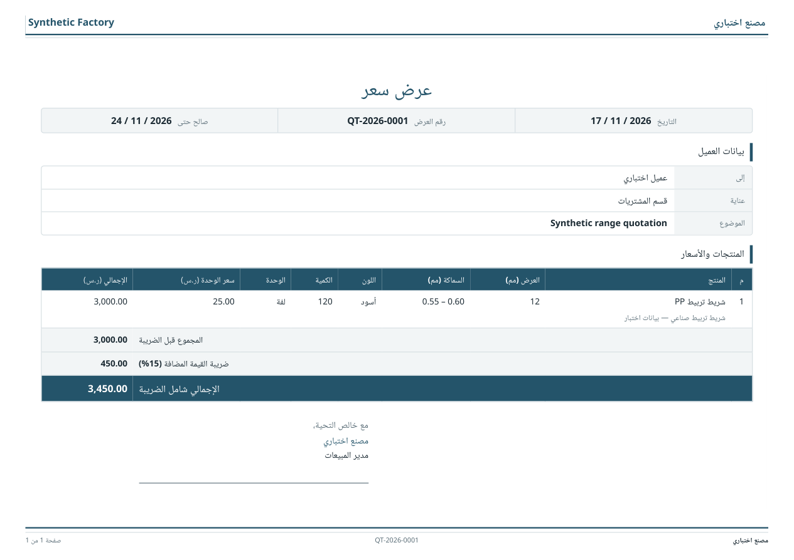
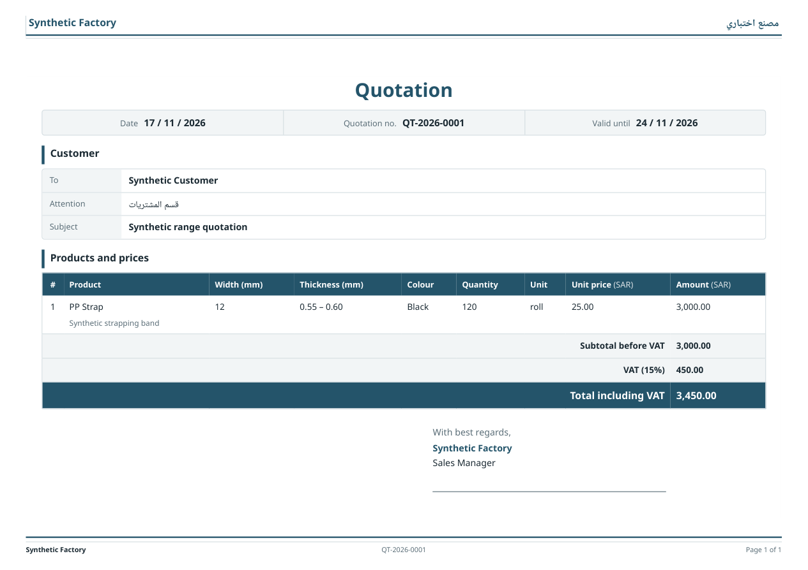
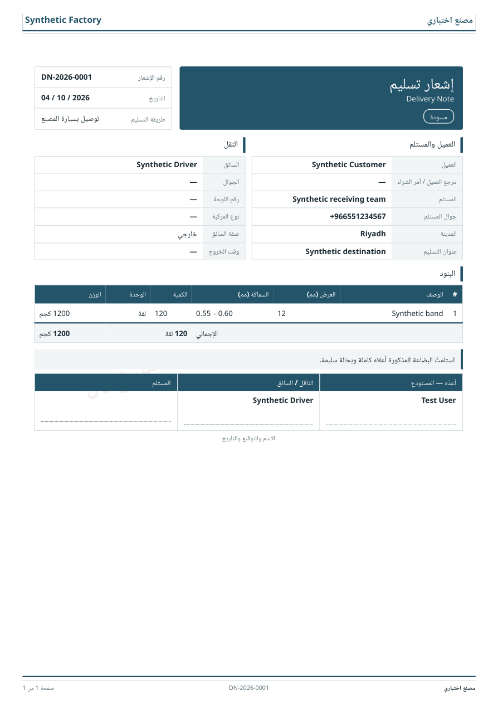

# Numeric specification ranges and document columns

Branch: `feat/spec-ranges-and-columns`, based on `1070ec5b1fd5f1724c0f14d751847e63657c47cb`.
All examples and screenshots are synthetic. No operational server or environment file is used.

## Design / التصميم

- A numeric product property opts in with `allows_range`, default false. Text/choice
  properties cannot enable it. A scalar remains a JSON number; a range is exactly
  `{min: number, max: number}`. Endpoints must be finite, ordered numbers (not
  booleans/strings). Equal endpoints become a scalar. The shared catalogue
  interface protects document writes without importing Master Data models.
- `core/specifications.py` owns normalization, numeric bounds and display.
  `core/units.spec_text` and document-specific specification readers delegate to
  it. Range endpoints share decimal precision; existing scalar values stay scalar.
- `core/interfaces/specification_columns.py` owns ordered template-column union,
  hiding empty properties, translated choices/labels, common-unit headers,
  mixed-unit cells and the final legacy/other-properties column.
- `NumericSpecInput` and `lib/spec-value.ts` share UI parsing/validation/display.
  Arabic-Indic/Persian digits and the Arabic decimal separator are accepted.
  Incomplete input stays editable; invalid or reversed input blocks submission
  with ar/en messages. Ranges are never saved as typed hyphenated strings.
- Production sorting compares minimum then maximum, while grouping still uses
  canonical full specification identity. Existing deep-copy boundaries preserve
  objects through quotation, sales order, demand and production allocations.
- Shipping/return thickness keeps its existing lower/scalar column and adds
  nullable `thickness_max_mm`. Equal endpoints clear the maximum. DB/API checks
  require an existing lower bound and maximum >= minimum. Copies and quality
  return reads retain both endpoints, then reconstruct a JSON range for lot data.
- Quality resolves an order-line range to inclusive acceptance limits, not an
  invented midpoint. Scalar measurement readings remain scalar. COA creation
  freezes both the product template DTO and lot values in `product_specification`;
  replacements retain that snapshot, so later catalogue edits cannot rewrite it.

النطاق كائن رقمي، وليس نصًا. التحقق والتنسيق واتحاد أعمدة المستندات مشتركة في
core. لا استيراد لنماذج وحدات أخرى. بيانات الاختبار واللقطات اصطناعية بالكامل.

## Documents / المستندات

| Document | Behavior |
| --- | --- |
| Quotation | Always A4 landscape; product with smaller manual description below; one column per valued template property; original amounts, totals, header/footer, terms and signature retained |
| Production order report | Independent product-specification columns; portrait through six specification columns, otherwise landscape |
| Customer sample reports | Template specification columns and separate internal-only notes; same automatic orientation policy |
| Production demand Excel export | The same shared column union over demand lines, native quantities/dates retained, portrait/landscape print setup by specification-column count |
| Delivery note / return | Existing fixed width/thickness columns; readable thickness interval in explicit LTR isolation; portrait |
| COA | Additional frozen product-specification columns; existing measurement/acceptance/result table retained; automatic orientation by specification-column count |
| Quality inspection reports | Shared range formatting in specification/lot-value panels |

Arabic tables retain RTL reading order; numeric intervals use explicit LTR `bdi`
in PDFs and UI displays. Only the quotation item table and page orientation change
within its document layout. Free-text attention/subject and organization language
selection are untouched.

## Migration / الترحيل

`f6a1b2p4` follows `f6a1b2p3`: product-property opt-in Boolean/check, upper
thickness columns/checks on both shipping line tables, and nullable frozen COA
product-specification JSON. Existing properties default false; existing shipment
maxima and historical COA snapshots remain null. Upgrade/downgrade/upgrade is
tested on PostgreSQL 16 in a disposable schema and through the actual Alembic
chain. Downgrade removes the newly introduced fields; take the normal verified
pre-migration backup and restore it if reverting ranged operational data.

## Intentionally unchanged boundaries / المسارات المتروكة

- `production/application/order_lines.py`: already calls the shared arrangement
  sorter and deep-copies specifications. Tests verify object preservation; no
  parallel range-specific grouping implementation is introduced.
- `commercial/application/sales_order_source.py` and planning copy paths: already
  deep-copy JSON objects; the new API-chain test verifies them unchanged.
- Shipping's fixed width field remains scalar; the requested schema extension is
  specifically thickness. Product-template numeric JSON properties independently
  support opt-in ranges. Quantities, prices and weights remain scalar arithmetic.
- Actual quality readings and TDS/COA measurement tables are measurements, not
  product-template item tables: keep their rows, using inclusive interval limits.
- Procurement PO/GRN lines contain descriptions/materials/quantities rather than
  product-template specification JSON; their fixed document tables stay intact.
- Commercial statement/summary, NCR/CAPA and aggregate reports without template
  item rows stay intact. Complaint source expectations are narrative text fields;
  their specification strings use the shared formatter, without changing that
  separate free-text contract or the original JSON source.
- Historical COAs with no snapshot are not backfilled from today's templates.

## Verification / التحقق

New tests cover invalid/nonfinite/reversed/non-opt-in ranges, scalar collapse,
production ordering/grouping, inclusive quality acceptance, unit/header union and
empty/legacy columns, API copy chains, frozen COA labels, and PostgreSQL constraints.
Frontend tests cover all requested input spellings/digits and numeric-only template
opt-in. A dedicated CI E2E job sends synthetic API-created documents through the
real pinned Chromium renderer and checks PDF dimensions/content before image
generation. Image publication depends on that E2E job as well as the existing gates.
Final command counts and CI status are in the PR.

## Reviewed synthetic screenshots / لقطات المراجعة

## Changed-path inventory

The following inventory lists source paths changed for range handling, document
columns, schema storage or display; tests and translations accompany these paths.

- `backend/app/commercial/api/schemas.py`
- `backend/app/commercial/application/complaint_service.py`
- `backend/app/commercial/application/order_service.py`
- `backend/app/commercial/application/quote_service.py`
- `backend/app/commercial/application/sample_service.py`
- `backend/app/commercial/reporting/customers/sample_sections.py`
- `backend/app/commercial/reporting/quotation/builder.py`
- `backend/app/commercial/reporting/quotation/definitions.py`
- `backend/app/commercial/reporting/quotation/templates/quote_body.html`
- `backend/app/commercial/reporting/quotation/templates/quote_styles.css`
- `backend/app/core/interfaces/product_catalog.py`
- `backend/app/core/interfaces/specification_columns.py`
- `backend/app/core/reporting/contracts.py`
- `backend/app/core/reporting/layout.py`
- `backend/app/core/reporting/service.py`
- `backend/app/core/reporting/templates/sections.html`
- `backend/app/core/specifications.py`
- `backend/app/core/units.py`
- `backend/app/masterdata/api/schemas.py`
- `backend/app/masterdata/application/catalog_provider.py`
- `backend/app/masterdata/application/services.py`
- `backend/app/masterdata/domain/rules.py`
- `backend/app/masterdata/infrastructure/models.py`
- `backend/app/production/application/demand_service.py`
- `backend/app/production/application/services.py`
- `backend/app/production/domain/arrangement.py`
- `backend/app/production/reporting/builders.py`
- `backend/app/production/reporting/demand_export.py`
- `backend/app/quality/api/inspection_schemas.py`
- `backend/app/quality/application/certificate_service.py`
- `backend/app/quality/application/measurement_service.py`
- `backend/app/quality/application/return_inspection_service.py`
- `backend/app/quality/application/support.py`
- `backend/app/quality/domain/specifications.py`
- `backend/app/quality/infrastructure/models.py`
- `backend/app/quality/reporting/builders.py`
- `backend/app/quality/reporting/certificate.py`
- `backend/app/quality/reporting/templates/coa_body.html`
- `backend/app/shipping/api/schemas.py`
- `backend/app/shipping/application/return_service.py`
- `backend/app/shipping/application/shipment_service.py`
- `backend/app/shipping/infrastructure/models.py`
- `backend/app/shipping/reporting/document.py`
- `backend/app/shipping/reporting/return_document.py`
- `backend/app/shipping/reporting/templates/dn_body.html`
- `backend/app/shipping/reporting/templates/rt_body.html`
- `frontend/src/components/forms/NumericSpecInput.tsx`
- `frontend/src/components/forms/SpecEditor.tsx`
- `frontend/src/features/commercial-orders/components/sales-lifecycle.tsx`
- `frontend/src/features/masterdata/components/Products.tsx`
- `frontend/src/features/production-demands/form.tsx`
- `frontend/src/features/production-demands/shared.tsx`
- `frontend/src/features/production-order-items/components/ProductionOrderItemForm.tsx`
- `frontend/src/features/production-order-items/components/ProductionOrderItemsList.tsx`
- `frontend/src/features/production-orders/components/ProductionOrderDetail.tsx`
- `frontend/src/features/quality-checks/api/quality-checks-api.ts`
- `frontend/src/features/quality-checks/components/MeasurementsSection.tsx`
- `frontend/src/features/quality-checks/types/index.ts`
- `frontend/src/features/quotes/components/QuoteItemsTable.tsx`
- `frontend/src/features/samples/components/SampleProperties.tsx`
- `frontend/src/features/samples/components/sample-errors.ts`
- `frontend/src/features/shipments/components/ReturnDetail.tsx`
- `frontend/src/features/shipments/components/ShipmentDetail.tsx`
- `frontend/src/features/shipments/components/ShipmentForm.tsx`
- `frontend/src/features/shipments/types.ts`
- `frontend/src/lib/api-error-handler.ts`
- `frontend/src/lib/spec-rows.ts`
- `frontend/src/lib/spec-value.ts`
